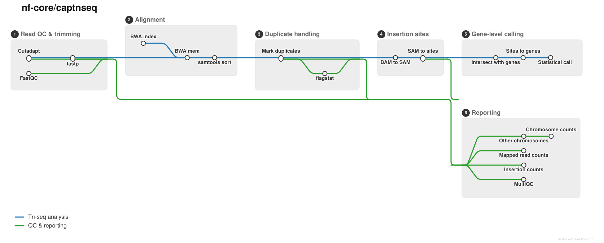

<h1>
  <picture>
    <source media="(prefers-color-scheme: dark)" srcset="docs/images/nf-core-captnseq_logo_dark.png">
    
  </picture>
</h1>

[](https://github.com/codespaces/new/nf-core/captnseq)
[](https://github.com/nf-core/captnseq/actions/workflows/nf-test.yml)
[](https://github.com/nf-core/captnseq/actions/workflows/linting.yml)[](https://nf-co.re/captnseq/results)[](https://doi.org/10.5281/zenodo.XXXXXXX)
[](https://www.nf-test.com)

[](https://www.nextflow.io/)
[](https://github.com/nf-core/tools/releases/tag/4.1.0)
[](https://docs.conda.io/en/latest/)
[](https://www.docker.com/)
[](https://sylabs.io/docs/)
[](https://cloud.seqera.io/launch?pipeline=https://github.com/nf-core/captnseq)

[](https://nfcore.slack.com/channels/captnseq)[](https://bsky.app/profile/nf-co.re)[](https://mstdn.science/@nf_core)[](https://www.youtube.com/c/nf-core)

## Introduction

**nf-core/captnseq** [provisional name] is a bioinformatics pipeline for bacterial and plasmid TIS/Tn-seq (transposon insertion sequencing) data. It takes paired-end short reads from a transposon-insertion library, maps them to a reference genome, calls the insertion sites, and uses the per-gene insertion density to classify every gene as **essential**, **ambiguous** or **non-essential**.

The pipeline is aimed at High-Throughput Transposon Mutagenesis (HTTM) experiments on large mutant collections. The current version covers the standard Tn-seq processing mode, from raw reads to gene essentiality. Genome-wide digenic interaction calling (synthetic-lethal and alleviating gene pairs) is the planned extension and is not part of the pipeline yet.

You provide a samplesheet of paired-end FASTQ files, a reference genome FASTA and a gene annotation in BED format. Everything else runs with defaults that are tuned for Tn5-style transposon libraries, and each step can be adjusted with the [parameters](#key-parameters) below.

## Pipeline summary



1. Raw read QC ([`FastQC`](https://www.bioinformatics.babraham.ac.uk/projects/fastqc/))
2. Adapter trimming of both mates ([`Cutadapt`](https://cutadapt.readthedocs.io/)), default adapter `ACTGTCTCTTATACACATCT`
3. Quality trimming and length filtering ([`fastp`](https://github.com/OpenGene/fastp)), with a sliding-window trim from the 3' end. Reads that fail, and orphaned mates, are kept in separate folders
4. Alignment to the reference genome ([`BWA-MEM`](https://github.com/lh3/bwa)); the BWA index is built from `--genome_fasta`
5. Mapping-quality filtering, name-sorting, `fixmate` and coordinate-sorting ([`samtools`](https://www.htslib.org/)). A sample with fewer than `--min_mapped_reads` mapped reads stops the run instead of producing silently poor results
6. Duplicate marking and removal ([`samtools markdup`](https://www.htslib.org/doc/samtools-markdup.html)), plus alignment statistics (`samtools flagstat`)
7. Insertion-site calling from the deduplicated reads ([`captnseq-toolkit sam2sites`](https://github.com/simonjeanneau/captnseq-toolkit)): one record per insertion site, written as BED and as normalised or raw, stranded or unstranded bedGraph tracks.
8. Assignment of insertion sites to genes ([`bedtools intersect`](https://bedtools.readthedocs.io/) and [`captnseq-toolkit sites2genes`](https://github.com/simonjeanneau/captnseq-toolkit)). The informative part of each gene can be restricted, so that insertions near the start or end of a gene can be ignored
9. Essentiality calling ([`captnseq-toolkit essentiality`](https://github.com/simonjeanneau/captnseq-toolkit), a Python port of the TRADIS essentiality script): genes are classified as essential, ambiguous or non-essential, with QC and changepoint plots for each sample
10. Run-level summaries: mapped reads, insertion-site counts and per-contig read counts for all samples
11. Aggregated QC report ([`MultiQC`](http://multiqc.info/))

## Usage

> [!NOTE]
> If you are new to Nextflow and nf-core, please refer to [this page](https://nf-co.re/docs/get_started/environment_setup/overview) on how to set-up Nextflow. Make sure to [test your setup](https://nf-co.re/docs/get_started/run-your-first-pipeline) with `-profile test` before running the workflow on actual data.

### Input files

**Samplesheet.** Create a comma-separated file with one row per sample (`samplesheet.csv`):

```csv
sample,fastq_1,fastq_2
mutant_pool_1,pool1_R1.fastq.gz,pool1_R2.fastq.gz
mutant_pool_2,pool2_R1.fastq.gz,pool2_R2.fastq.gz
```

| Column    | Description                                                                |
| --------- | -------------------------------------------------------------------------- |
| `sample`  | Sample name, without spaces. Used to name every output file of the sample. |
| `fastq_1` | Path or URL of the gzipped R1 FASTQ file (`.fastq.gz` or `.fq.gz`).        |
| `fastq_2` | Path or URL of the gzipped R2 FASTQ file.                                  |

> [!IMPORTANT]
> captnseq works with **paired-end reads only**. A row without `fastq_2` is rejected when the pipeline starts, as are FASTQ files smaller than `--min_fastq_size_bytes`.

**Reference genome.** `--genome_fasta` is the FASTA file of the genome the library was built in. It can contain several contigs, for example a chromosome and plasmids, and reads are counted per contig.

**Gene annotation.** `--genome_features` is a tab-separated, headerless BED6 file with one line per gene or feature to score: `chromosome`, `start`, `end`, `name`, `score`, `strand`. The chromosome names must match the contig names in the FASTA file.

```
chr1    37      1816    geneA   900     -
chr1    2291    3482    geneB   900     +
```

### Running the pipeline

```bash
nextflow run nf-core/captnseq \
   -profile docker \
   --input samplesheet.csv \
   --genome_fasta genome.fasta \
   --genome_features genes.bed \
   --outdir results
```

Replace `docker` with `singularity`, `apptainer`, `conda` or the profile of your institution. To try the pipeline on the small bundled dataset first, use `-profile test,docker --outdir results`.

> [!WARNING]
> Please provide pipeline parameters via the CLI or Nextflow `-params-file` option. Custom config files including those provided by the `-c` Nextflow option can be used to provide any configuration _**except for parameters**_; see [docs](https://nf-co.re/docs/running/run-pipelines#using-parameter-files).

### Key parameters

| Parameter                | Default                | Description                                                                                    |
| ------------------------ | ---------------------- | ---------------------------------------------------------------------------------------------- |
| `--input`                |                        | Samplesheet (required).                                                                        |
| `--outdir`               |                        | Output directory (required).                                                                   |
| `--genome_fasta`         |                        | Reference genome FASTA (required).                                                             |
| `--genome_features`      |                        | Gene annotation, BED6 (required).                                                              |
| `--adapter_seq`          | `ACTGTCTCTTATACACATCT` | Adapter trimmed by Cutadapt from both mates.                                                   |
| `--trim_minlen`          | `10`                   | Minimum read length kept after trimming.                                                       |
| `--fastp_qual_threshold` | `10`                   | Mean quality for fastp's sliding-window trimming.                                              |
| `--mapQ_threshold`       | `10`                   | Minimum mapping quality kept after alignment.                                                  |
| `--min_fastq_size_bytes` | `10000`                | Refuse to start if any input FASTQ is smaller than this.                                       |
| `--min_mapped_reads`     | `1000`                 | A sample with fewer mapped reads fails the run.                                                |
| `--execution_mode`       | `single_thread`        | `single_thread` or `multi_thread`: selects the CPU, memory and time tier used by each process. |

The complete list is in the [parameter documentation](https://nf-co.re/captnseq/parameters). For more details and further functionality, please refer to the [usage documentation](https://nf-co.re/captnseq/usage).

## Pipeline output

The results directory contains one folder per stage. Every file name starts with the sample name.

| Folder                  | Content                                                                                                                                                                                                                 |
| ----------------------- | ----------------------------------------------------------------------------------------------------------------------------------------------------------------------------------------------------------------------- |
| `fastqc/`               | FastQC reports of the raw reads.                                                                                                                                                                                        |
| `01_cutadapt/`          | Adapter-trimmed reads and Cutadapt logs.                                                                                                                                                                                |
| `02_QualTrim/`          | Quality-trimmed reads, fastp reports (`QC/`), and reads that failed or lost their mate (`FAILED/`, `UNPAIRED/`).                                                                                                        |
| `reference/`            | The BWA index built from `--genome_fasta`.                                                                                                                                                                              |
| `03_mapped/`            | Filtered, sorted alignments and `flagstat` statistics.                                                                                                                                                                  |
| `04_filtered/`          | Duplicate-marked and deduplicated BAM files, duplicate metrics, and per-contig read counts.                                                                                                                             |
| `05_sitescall/`         | Insertion sites as BED and bedGraph tracks, from the deduplicated reads.                                                                                                                                                |
| `06_intersection/`      | Insertion sites overlapping each gene of the annotation.                                                                                                                                                                |
| `07_statisticalreport/` | **Main results.** Insertions per gene (`*-genes_insertions.tsv`), the essentiality calls (`*.essen.csv`, `*.ambig.csv`, `*.nonessen.csv`, `*.all.csv`) and QC and changepoint plots (`*_QC_and_changepoint_plots.pdf`). |
| `09_sample_summary/`    | Run-level tables: `1_mapped_summary.tsv`, `2_insertion_summary.tsv` and `3_chr_count.tsv`.                                                                                                                              |
| `multiqc/`              | The MultiQC report, `multiqc_report.html`, combining the FastQC, Cutadapt, fastp and flagstat results.                                                                                                                  |
| `pipeline_info/`        | Nextflow execution reports and the versions of all tools used.                                                                                                                                                          |

In the essentiality tables, each row is a gene with its length, the number of insertion sites (`ins_count`), the number of reads (`read_count`) and the insertion index (`ins_index`, insertions per base). The classification uses the two thresholds reported in the same table, `F_threshold` and `N_threshold`.

To see the results of an example test run with a full size dataset refer to the [results](https://nf-co.re/captnseq/results) tab on the nf-core website pipeline page.
For more details about the output files and reports, please refer to the
[output documentation](https://nf-co.re/captnseq/output).

## Credits

nf-core/captnseq was originally written by Simon Jeanneau.

We thank the following people for their extensive assistance in the development of this pipeline:

## Contributions and Support

If you would like to contribute to this pipeline, please see the [contributing guidelines](docs/CONTRIBUTING.md).

For further information or help, don't hesitate to get in touch on the [Slack `#captnseq` channel](https://nfcore.slack.com/channels/captnseq) (you can join with [this invite](https://nf-co.re/join/slack)).

## Citations

<!-- TODO nf-core: Add citation for pipeline after first release. Uncomment lines below and update Zenodo doi and badge at the top of this file. -->
<!-- If you use nf-core/captnseq for your analysis, please cite it using the following doi: [10.5281/zenodo.XXXXXX](https://doi.org/10.5281/zenodo.XXXXXX) -->

An extensive list of references for the tools used by the pipeline can be found in the [`CITATIONS.md`](CITATIONS.md) file.

You can cite the `nf-core` publication as follows:

> **The nf-core framework for community-curated bioinformatics pipelines.**
>
> Philip Ewels, Alexander Peltzer, Sven Fillinger, Harshil Patel, Johannes Alneberg, Andreas Wilm, Maxime Ulysse Garcia, Paolo Di Tommaso & Sven Nahnsen.
>
> _Nat Biotechnol._ 2020 Feb 13. doi: [10.1038/s41587-020-0439-x](https://dx.doi.org/10.1038/s41587-020-0439-x).
